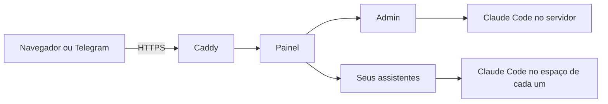

<p align="center">
  <picture>
    <source media="(prefers-color-scheme: dark)" srcset="docs/assets/banner-escuro.png">
    
  </picture>
</p>

<p align="center">
  <a href="https://github.com/diegohoraadm-cpu/prumo-da-locadora/actions/workflows/ci.yml"></a>
  <a href="LICENSE"></a>
</p>

## O que é

O Prumo da Locadora é um assistente de IA que trabalha para o dono de locadora, num servidor que é seu.
Você conversa com ele pelo navegador ou pelo Telegram, ele lembra do que você disse, organiza tarefas e
cria outros assistentes para funções da loja (comercial, financeiro, manutenção), cada um isolado no
próprio espaço.

Ele usa a sua assinatura do Claude (ou do Codex), então não há chave de API para pagar à parte. Seus
dados ficam no seu servidor.

Feito pela **LocaAção** para os locadores da Escola do Locador, a partir do
[DG Claw](https://github.com/DGatoM/DG-Claw), de DG Medeiros (licença MIT). O crédito completo está em
[NOTICE.md](NOTICE.md).

## Antes da instalação: 3 coisas prontas

1. **Servidor (VPS)** com Ubuntu 24.04 puro, sem painel: Hostinger KVM 2 ou equivalente (2 GB de memória
   no mínimo, 15 GB livres, portas 80 e 443 livres). Guarde a senha de root.
2. **Assinatura do Claude** ativa (Pro ou superior), com login e senha em mãos.
3. **Bot do Telegram** criado no @BotFather (`/newbot`), com o token guardado. Opcional: dá para começar
   só pelo navegador.

## Instalação, passo a passo

Leva de 20 a 30 minutos. Os comandos vão no terminal do servidor.

**Passo 1. Entrar no servidor.** No painel da Hostinger, abra a VPS e use o **Terminal do navegador**.
Ou, no computador:

```sh
ssh root@IP-DO-SEU-SERVIDOR
```

**Passo 2. Instalar o Claude Code.** Cole as duas linhas, uma de cada vez:

```sh
curl -fsSL https://claude.ai/install.sh | bash
echo 'export PATH="$HOME/.local/bin:$PATH"' >> ~/.bashrc && source ~/.bashrc
```

**Passo 3. Entrar na sua assinatura do Claude.** Rode `claude`, escolha o tema, escolha entrar com a
assinatura, abra o link no navegador do computador, faça o login e cole o código de volta no terminal.
Quando ele abrir a conversa, saia com `/exit`.

```sh
claude
```

**Passo 4. Instalar o Prumo da Locadora.** Troque `seunome` pelo usuário que você quer usar no painel:

```sh
git clone https://github.com/diegohoraadm-cpu/prumo-da-locadora
cd prumo-da-locadora
sudo ./install.sh --usuario seunome --com-imagem
```

O instalador mostra cada etapa em português. No fim aparecem o **endereço do painel**, o **usuário** e
um **link de primeiro acesso**. Pode rodar de novo sem estragar nada.

**Passo 5. Criar a senha.** Abra o link de primeiro acesso no navegador (vale 30 minutos e uma vez só) e
cadastre uma senha de pelo menos 12 caracteres. Você entra direto no chat do **Admin**. Se o link
vencer: `sudo dgclaw primeiro-acesso`.

**Passo 6. Criar o seu assistente.** No card do Admin, toque em **Quero criar meu primeiro agente**, dê
um nome e diga a função. Quando aparecer **Conectar minha assinatura**, abra o painel do agente, aba
Status, e use **Entrar com a assinatura** (é o mesmo login do passo 3, agora dentro do assistente).
Volte e toque em **Já entrei. Pode testar.**

**Passo 7. Ligar o Telegram.** Abra a conversa com o **seu assistente** (não com o Admin) e mande uma
mensagem só com o token do bot, sem nenhuma palavra junto. O painel guarda o token em segredo e mostra só
o final dele. Em seguida mande "oi" para o bot no celular e avise o assistente: ele confirma que é você
(só o seu Telegram fica liberado) e liga o canal.

Travou em algum passo? Veja [Se algo der errado](#se-algo-der-errado). O guia técnico completo, com cada
opção do instalador, está em [INSTALL.md](INSTALL.md).

## O que ele faz

- **Admin**: cria e administra os outros assistentes por conversa, e cuida do servidor.
- **Um espaço por assistente**: cada um tem os próprios arquivos e o próprio cofre de senhas, sem enxergar os outros.
- **Memória**: acha o que você disse pelo sentido, mesmo com outras palavras.
- **Mesa de tarefas**: uma tela com o que cada assistente está fazendo, o que travou e o que espera por você.
- **Canais**: chat no navegador, Telegram e, se quiser, WhatsApp ([docs/CANAL-WHATSAPP.md](docs/CANAL-WHATSAPP.md)).
- **Modo escondido**: esconde nomes, valores e senhas da tela para mostrar uma conversa sem expor dados.
- **Saúde e emergência**: o painel confere se cada assistente está respondendo, e há um roteiro de socorro ([docs/EMERGENCIA.md](docs/EMERGENCIA.md)).

## Se algo der errado

- **"não acho o comando claude"**: rode de novo a segunda linha do passo 2 e repita o passo 4.
- **"Claude não está logado"**: faça o passo 3 e repita o passo 4.
- **Porta 80 ou 443 ocupada**: o servidor já tem outro sistema (Easypanel, por exemplo). Use uma VPS nova, com Ubuntu puro.
- **O painel não abre em HTTPS**: espere 2 minutos; se continuar, confira no painel da Hostinger se as portas 80 e 443 estão liberadas.
- **Criar o primeiro assistente demora**: na primeira vez ele prepara a imagem (de 10 a 20 minutos). A tela acompanha; não repita a instalação.

## Segurança, em uma linha cada

- Só o endereço HTTPS fica aberto na internet; o resto roda dentro do servidor.
- Senha guardada só como hash, com limite de tentativas; as chaves do cofre nunca aparecem inteiras.
- Cada assistente começa com poderes limitados (o Gmail nasce só lendo) e você libera aos poucos.
- Limite conhecido: quem tem a senha de root do servidor enxerga tudo. Guarde essa senha.

Detalhes em [docs/SEGURANCA.md](docs/SEGURANCA.md). Para relatar uma falha, veja o [SECURITY.md](SECURITY.md).

## Atualizar e fazer backup

Peça ao Admin: **"atualiza o Prumo da Locadora"**. Ele faz um backup datado, baixa a versão nova e
confere que senha, memória, conversas e cofres continuam iguais. No terminal, o mesmo é
`sudo dgclaw atualizar` (`--simular` mostra antes, `--voltar <backup>` desfaz). Passo a passo em
[docs/ATUALIZAR.md](docs/ATUALIZAR.md).

## Como funciona por dentro

O navegador chega ao Caddy (HTTPS), que entrega o painel. O painel autentica você e passa cada mensagem
ao assistente certo, que mantém viva a sessão do Claude Code ou do Codex. Descrição completa em
[docs/ARQUITETURA.md](docs/ARQUITETURA.md).



## Licença

MIT. Veja [LICENSE](LICENSE) e [NOTICE.md](NOTICE.md). Prumo da Locadora é uma adaptação da LocaAção
sobre o DG Claw, de DG Medeiros.
